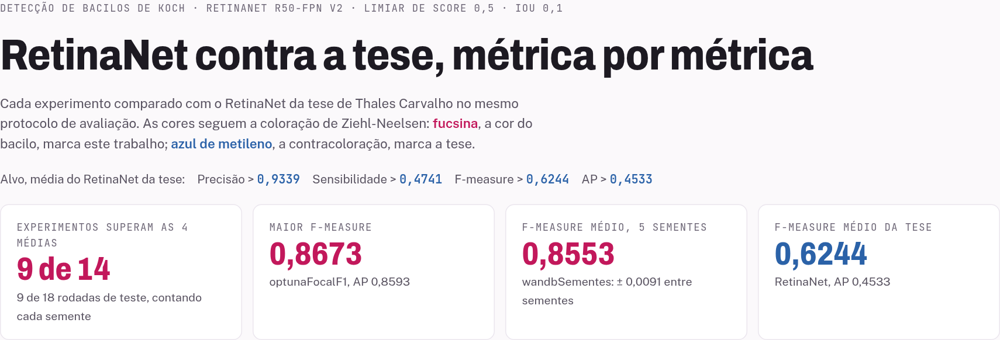
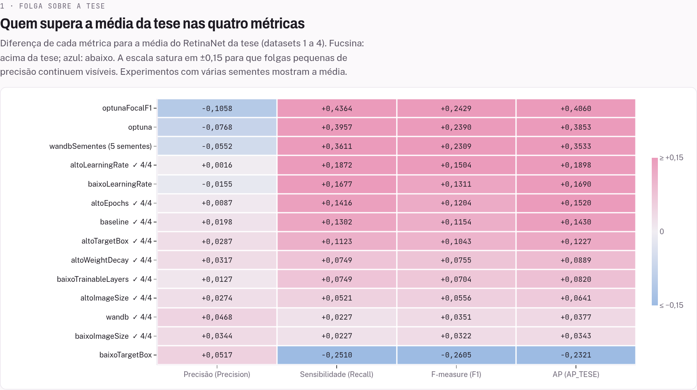
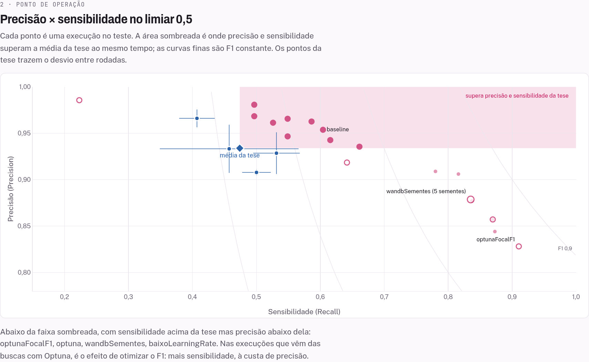
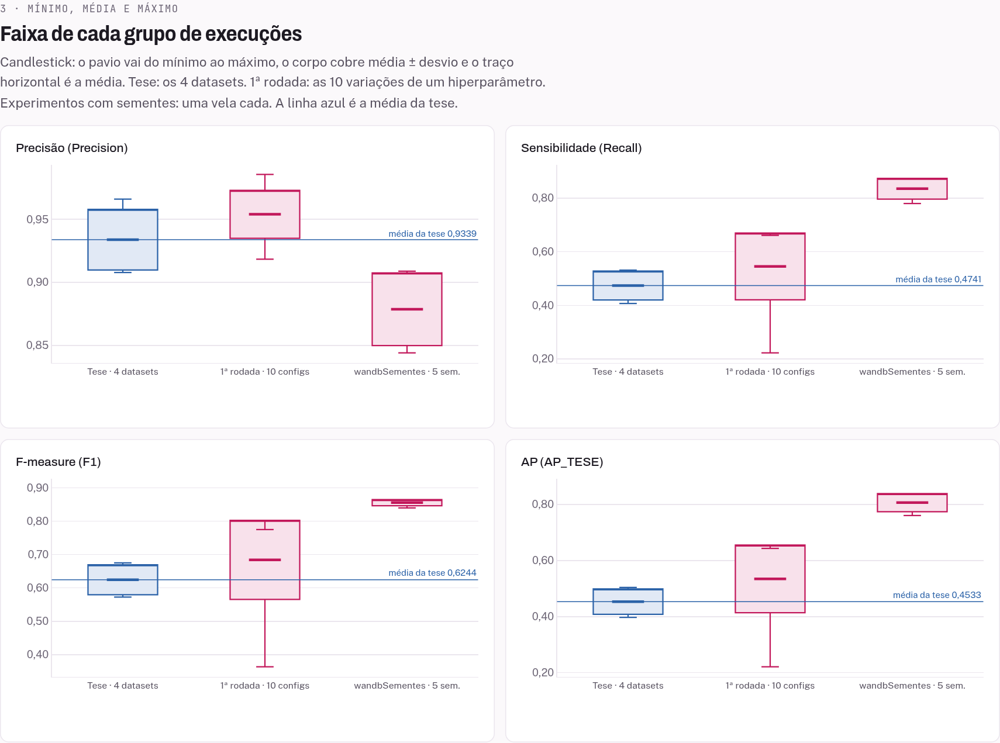
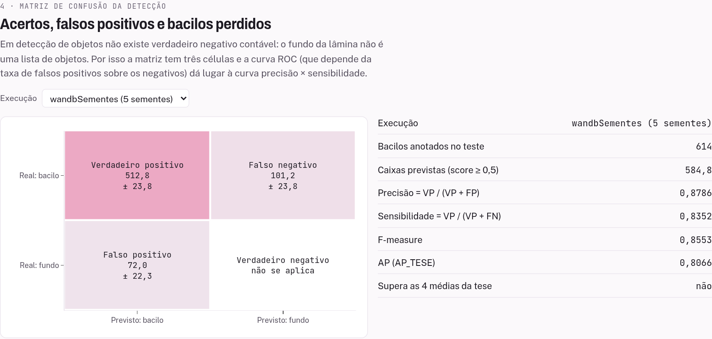
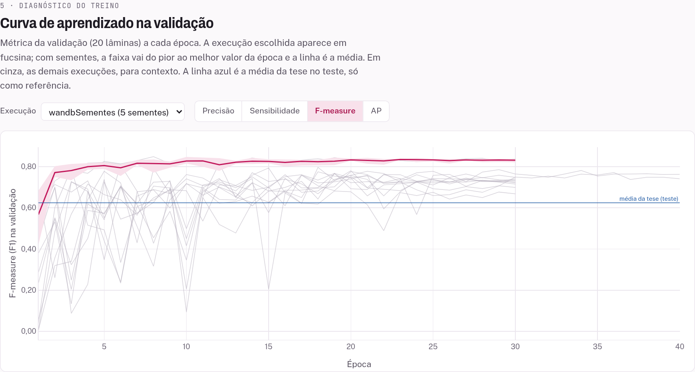

# RetinaNet para detecção de bacilos de Koch

Experimentos de hiperparâmetros com o RetinaNet R50-FPN v2 para detectar bacilos da tuberculose em lâminas coradas por Ziehl-Neelsen. O objetivo é superar o RetinaNet da tese de Thales Carvalho no mesmo protocolo de avaliação, e entender por que cada mudança ajuda ou atrapalha.

O ponto de partida foi a tabela da tese (`resultados-thales-todos-modelos.md`). Na média dos quatro datasets dela, o RetinaNet chega a:

| Precisão | Sensibilidade | F-measure | AP |
|---|---|---|---|
| 0,9339 | 0,4741 | 0,6244 | 0,4533 |

## Como o projeto está organizado

O código do detector existe uma vez só, em `retinanet-base/`. Cada experimento é uma pasta em `retinanet-experimentos/` com apenas o que muda: um `run.py` com os hiperparâmetros, um `.md` que diz o que variou em relação à base e, depois de rodar, o log completo da plataforma em `resultados-*.md`.

```
retinanet-base/                 retinanet-experimentos/<nome>/
  RetinaDataset.py  ─┐            run.py           (hiperparâmetros)
  RetinaModel.py     ├─ enviados  requirements.txt (só quando precisa: optuna, wandb)
  RetinaExperiment.py┘  juntos ─▶ <nome>.md        (o que mudou e por quê)
                                  resultados-*.md  (log completo da Flautim)
                                          │
                                          ▼
                        retinanet-visualizacao/gerar_visualizacao.py
                                          │
                                          ▼
                        painel HTML com métricas, gráficos e linha do tempo
```

A separação existe por causa da plataforma Flautim, que executa os experimentos. Ela copia os arquivos de um experimento para uma pasta só, sem subpastas, e roda `python3 run.py` dali. Por isso os imports são planos (`import RetinaDataset`), o ponto de entrada sempre se chama `run.py`, e um experimento novo nunca precisa copiar o detector: basta um `run.py` diferente.

Os logs ficam no repositório de propósito. Eles são a fonte de verdade: o painel e os resultados deste README saem deles, com data e hora de cada treino.

## O problema e a estratégia

As 200 lâminas do `Annotation.csv` têm até 2560 × 2557 px e 3145 caixas anotadas (2941 bacilos e 204 aglomerados, tratados como uma classe só). O bacilo mediano tem ~72 px de lado. Encolher a lâmina inteira para caber na rede deixaria os bacilos com poucos pixels, então o `RetinaDataset` faz o contrário:

1. reescala cada lâmina para o bacilo mediano ficar com ~40 px (fator 0,5533 neste dataset);
2. treina com recortes de 640 × 640 px, a maioria centrados num bacilo, com espelhamentos, rotações e variação de cor da coloração;
3. avalia a lâmina inteira em ladrilhos com sobreposição e junta as detecções com NMS.

O split é por lâmina, com semente fixa: 139 de treino, 20 de validação e 40 de teste (614 bacilos). Uma das 200 imagens é ilegível e fica de fora.

## Protocolo de avaliação

Para os números serem comparáveis com a tese, o `RetinaExperiment` reproduz o notebook do Thales:

- uma detecção acerta se tem IoU ≥ 0,1 com um bacilo ainda não casado, em ordem de score (o bacilo é fino e a anotação é imprecisa, então IoU 0,5 puniria caixas corretas);
- Precisão, Sensibilidade e F-measure são medidas no limiar de score **0,5**;
- o AP (`AP_TESE`) varre os limiares de 0,20 a 0,85.

A comparação com a tese é sempre no limiar 0,5. O limiar escolhido na validação dá números melhores, mas muda a régua. O log também traz AP_VOC e as métricas com IoU 0,5 (AP50, F1_IOU50), que a tese não reporta.

## Rodar um experimento na Flautim

Envie para a plataforma, juntos:

- os três módulos de `retinanet-base/`;
- o `run.py` da pasta do experimento;
- o `requirements.txt` da pasta, se existir. Ele substitui o da base, que é propositalmente vazio.

O dataset é lido de `/home/flautim_workplace/datasets/db_tb/Dataset/` (ou da mesma árvore sob `/mnt`, conforme o cluster). Quase todo hiperparâmetro pode ser trocado por variável de ambiente sem editar código, por exemplo `RETINA_LR`, `RETINA_EPOCHS`, `RETINA_BATCH_SIZE` e `RETINA_SEEDS`; cada `run.py` lista as suas no topo.

Não acrescente pacotes ao `requirements.txt` sem travar `numpy==1.26.4`. A imagem da plataforma (`experiments-gpu:0.2`, Python 3.12) foi compilada contra o NumPy 1.x, e um pacote que puxe o NumPy 2 quebra torch, cv2 e pycocotools de uma vez. Foi o que derrubou um treino em 17/09/2026, e é por isso que o dataset não usa albumentations.

Um treino de 30 épocas leva de 20 a 36 minutos numa Quadro RTX 6000 e usa menos de 5 GB de VRAM. As buscas com Optuna levam de 2 a 3 horas.

## Criar um experimento novo

1. Copie a pasta do experimento mais parecido com o que você quer testar e renomeie no padrão `retinanet-<variacaoEmCamelCase>`.
2. Mude os valores padrão no `run.py` e diga no `.md` o que mudou e por quê.
3. Depois de rodar, cole o **log completo** da plataforma em `resultados-retinanet-<nome>.md`. Só as últimas linhas não bastam: o tempo de treino e as curvas por época estão no meio do log.
4. Rode `python3 gerar_visualizacao.py` em `retinanet-visualizacao/`. O experimento entra sozinho no painel e na linha do tempo deste README. Para atualizar as imagens do README, rode também `python3 capturar_imagens.py`.

Os experimentos com Optuna e com sementes ajustam a perda focal (`focal_alpha`, `focal_gamma`) e o matcher de âncoras (`fg_iou`) dentro do próprio `run.py`, sem tocar no `RetinaModel.py`. Copie essas funções junto se o seu experimento precisar delas.

## Painel de diagnóstico

O painel junta todos os experimentos numa página: **[abrir o painel](https://bernardozschaber.me/retinanet/retinanet-visualizacao/retinanet-visualizacao.html)**. Ele também abre direto do arquivo `retinanet-visualizacao/retinanet-visualizacao.html`, e funciona nos temas claro e escuro.

As cores seguem a coloração de Ziehl-Neelsen, o método padrão do diagnóstico da tuberculose: **fucsina**, a cor em que o bacilo fica, marca este trabalho; **azul de metileno**, a contracoloração do fundo da lâmina, marca a tese.



**Folga sobre a tese.** Cada experimento contra cada uma das quatro métricas, como diferença para a média do RetinaNet da tese. É a resposta direta à pergunta do projeto: quem supera a tese, em quê e por quanto. A marca "4/4" indica quem supera as quatro ao mesmo tempo.



**Ponto de operação.** Precisão contra sensibilidade no limiar 0,5. A área sombreada é onde as duas superam a tese. O gráfico mostra a troca que os experimentos com Optuna fizeram: mais sensibilidade, à custa de precisão abaixo da tese.



**Mínimo, média e máximo.** Um candlestick por grupo: os 4 datasets da tese, as 10 configurações da 1ª rodada e cada experimento com várias sementes. O pavio vai do mínimo ao máximo e o corpo cobre média ± desvio, então dá para comparar a variação, e não só a média.



**Matriz de confusão da detecção.** Verdadeiros positivos, falsos positivos e bacilos perdidos de cada execução. Em detecção de objetos não existe verdadeiro negativo contável, porque o fundo da lâmina não é uma lista de objetos; por isso a curva ROC não se aplica, e o painel usa a curva precisão × sensibilidade no lugar dela.



**Curva de aprendizado.** A métrica da validação época a época, com a faixa entre a melhor e a pior semente. Mostra quando o treino estabiliza e quanto as sementes divergem.



O painel traz ainda o custo em tempo de treino, a tabela completa, os hiperparâmetros de cada treino e a linha do tempo que está no fim deste README.

### Atualizar o painel

`retinanet-visualizacao/gerar_visualizacao.py` lê os logs e gera o painel, sem nenhum pacote além da biblioteca padrão do Python. O mesmo script reescreve a linha do tempo deste README. O visual fica em `modelo.html`: para mudar o painel, edite o modelo e gere de novo, porque o HTML gerado é sobrescrito a cada execução. As imagens acima saem de `capturar_imagens.py`, que precisa do Playwright com Chromium.

## Resultados até agora

No teste, limiar 0,5:

| Execução | Precisão | Sensibilidade | F-measure | AP |
|---|---|---|---|---|
| Tese, RetinaNet (média dos 4 datasets) | 0,9339 | 0,4741 | 0,6244 | 0,4533 |
| Baseline | 0,9537 | 0,6042 | 0,7398 | 0,5963 |
| altoLearningRate (1ª rodada) | 0,9355 | 0,6612 | 0,7748 | 0,6431 |
| optunaFocalF1 (1 semente) | 0,8281 | 0,9104 | 0,8673 | 0,8593 |
| wandbSementes (média de 5 sementes) | 0,8787 ± 0,0288 | 0,8352 ± 0,0388 | 0,8553 ± 0,0091 | 0,8066 ± 0,0323 |

Os achados principais:

- **O baseline já supera a média da tese nas quatro métricas.** Dos 14 experimentos rodados até 11/10/2026, 9 superam as quatro ao mesmo tempo, contando o baseline.
- **O alpha da perda focal é a alavanca de calibração.** Com 0,25 o modelo marca pouco e quase sempre certo; com 0,5 a 0,6 a sensibilidade chega a 0,87–0,91, mas a precisão cai abaixo da tese. O gamma pesa sete vezes menos que o alpha.
- **Uma semente só engana.** A semente que deu F1 0,8634 foi a melhor de cinco; a média real é 0,855. Diferenças de AP abaixo de ~0,03 entre execuções de uma semente são ruído.

Os dois próximos experimentos já estão prontos: `retinanet-wandbSementesFocalF1`, que confirma a 2ª busca com cinco sementes, e `retinanet-optunaSuperaTese`, que busca superar as quatro métricas da tese ao mesmo tempo, com folga.

## Linha do tempo

O que cada rodada ensinou, em ordem cronológica. Os horários de início e fim saem dos logs, e os números são os do teste no limiar 0,5. Este trecho é gerado por `gerar_visualizacao.py`; edite a lista `LINHA_DO_TEMPO` no script, não o texto abaixo.

<!-- linha-do-tempo:inicio -->
- **07/10/2026 (12:16–12:44) · Baseline** · _log auditado_ \
  `baseline` \
  `P 0,9537 · R 0,6042 · F1 0,7398 · AP 0,5963 · 27 min de treino` \
  **O que ensinou:** A configuração base já supera a média do RetinaNet da tese nas quatro métricas. A estratégia de ladrilhos de 640 px, com a imagem reescalada para o bacilo mediano ter ~40 px, resolve o problema dos bacilos pequenos demais. O ponto fraco é a sensibilidade: o modelo acerta quase tudo o que marca, mas deixa 40% dos bacilos sem marcar.

- **08/10/2026 (08:45–11:04) · 1ª rodada: um hiperparâmetro por vez** · _log auditado_ \
  `altoLearningRate` · `baixoLearningRate` · `altoEpochs` · `altoWeightDecay` · `altoImageSize` · `baixoImageSize` · `altoTargetBox` · `baixoTargetBox` · `baixoTrainableLayers` \
  `melhor: altoLearningRate, F1 0,7748 · AP 0,6431 · 8 de 10 configurações superam as 4 médias` \
  **O que ensinou:** Mexer no learning rate foi o que mais rendeu. Ladrilho e escala fora de 640 px / 40 px pioraram, e congelar camadas ou dobrar o weight decay também. 40 épocas ganharam só +0,005 de F1 por 31% a mais de tempo. O baixoTargetBox desabou (sensibilidade 0,22): bacilos a 32 px ficam pequenos demais para as âncoras. A pista mais importante: com o limiar escolhido na validação o F1 chegava a ~0,86, então o modelo já detectava bem e o problema era a calibração dos scores.

- **10/10/2026 · Decisão: comparar só no limiar 0,5** · _decisão_ \
  `alvo: P > 0,9339 · R > 0,4741 · F1 > 0,6244 · AP > 0,4533` \
  **Por quê:** O limiar escolhido na validação dá números melhores, mas muda a régua. Para a comparação com a tese ser justa, tudo passou a ser medido no limiar 0,5, e as análises com limiar menor saíram. A partir daqui, melhorar significa calibrar o modelo para o 0,5.

- **10/10/2026 (15:29–18:15) · 1ª busca com Optuna** · _log auditado_ \
  `optuna` \
  `P 0,8571 · R 0,8697 · F1 0,8634 · AP 0,8386 · busca 140 min + treino 27 min` \
  **O que ensinou:** O alpha da perda focal é a alavanca da calibração. Os 5 melhores trials usaram alpha 0,5, o maior valor permitido, contra 0,25 do padrão, e grad_clip 5. A sensibilidade saltou de 0,60 para 0,87 e o limiar ideal na validação subiu de 0,35 para 0,55: o 0,5 da tese virou praticamente o corte certo. O preço: a precisão caiu para 0,857, abaixo dos 0,934 da tese, e o AP50 caiu de 0,795 para 0,764, com caixas um pouco menos justas (fg_iou 0,4).

- **10/10/2026 (18:16–18:50) · Treino com Weights & Biases** · _log auditado_ \
  `wandb` \
  `P 0,9807 · R 0,4967 · F1 0,6595 · AP 0,4910 · 34 min de treino` \
  **O que ensinou:** Somar duas melhorias isoladas (lr 1e-2 e 40 épocas) com lote 8 não somou os ganhos: o F1 ficou abaixo do baseline. O melhor checkpoint saiu na época 13 de 40, então mais épocas não ajudaram. O W&B rodou offline por falta de chave, o que não atrapalha o treino: os gráficos só aparecem depois de um wandb sync.

- **10/10/2026 (19:35–22:06) · 2ª busca: focal loss e F1 no 0,5** · _log auditado_ \
  `optunaFocalF1` \
  `P 0,8281 · R 0,9104 · F1 0,8673 · AP 0,8593 · busca 125 min, 12 de 20 trials podados` \
  **O que ensinou:** O alpha virou o hiperparâmetro mais importante da busca (importância 0,33). O gamma pesou sete vezes menos (0,05): 1,5 e 2,0 deram resultados parecidos, e o vencedor usou 1,5, que suprime menos os exemplos fáceis e, junto com alpha 0,6, tende a empurrar os scores para cima. O alpha 0,75 não apareceu entre os 5 melhores, então o ótimo fica entre 0,5 e 0,6. Lote 8 apareceu em todos os 5 melhores. Com alpha 0,6 a calibração passou um pouco do ponto: o limiar ideal na validação foi 0,60 e a precisão caiu para 0,83.

- **11/10/2026 (22:00 (10/10)–00:11) · Cinco sementes da melhor configuração** · _log auditado_ \
  `wandbSementes` \
  `F1 0,8553 ± 0,0091 · AP 0,8066 ± 0,0323 · P 0,8787 ± 0,0288 · R 0,8352 ± 0,0388` \
  **O que ensinou:** A semente 42 repetiu exatamente o resultado da 1ª busca, prova de que o treino é reprodutível. Mas ela foi a melhor das cinco: o 0,8634 era otimista, e a média real é 0,855. O AP varia 3,5 vezes mais que o F1 entre sementes, então diferenças de AP abaixo de ~0,03 numa semente só são ruído. Mesmo assim, o F1 fica 0,18 acima do melhor dataset da tese, mais de seis desvios de distância.

- **11/10/2026 · Confirmar a 2ª busca com sementes** · _aguardando log_ \
  `wandbSementesFocalF1` \
  `referência: wandbSementes, F1 0,8553 ± 0,0091` \
  **Por que foi criado:** O ganho da 2ª busca sobre a 1ª (+0,004 de F1, +0,021 de AP) é menor que o desvio entre sementes. Só a média de cinco sementes diz se alpha 0,6 com lote 8 é melhor de fato. A semente 42 deve repetir F1 0,8673, o que confirma que a configuração foi aplicada.

- **11/10/2026 · Superar as quatro médias ao mesmo tempo, com folga** · _aguardando log_ \
  `optunaSuperaTese` \
  `9 de 14 experimentos já superam as 4 médias; os do Optuna falham só na precisão` \
  **Por que foi criado:** Otimizar só o F1 levou a busca a trocar precisão por sensibilidade até a precisão cair abaixo da tese. A busca seguinte exige as quatro métricas acima da tese com folga de 0,01 e só então maximiza o F1, explorando alpha entre 0,25 e 0,5, a faixa entre a precisão alta da 1ª rodada e a sensibilidade alta do Optuna.
<!-- linha-do-tempo:fim -->
