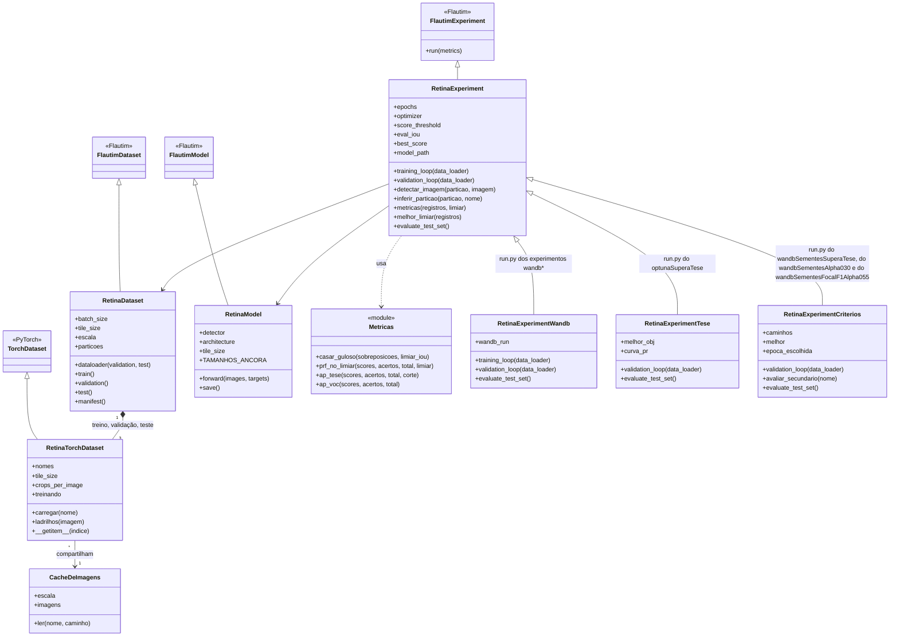
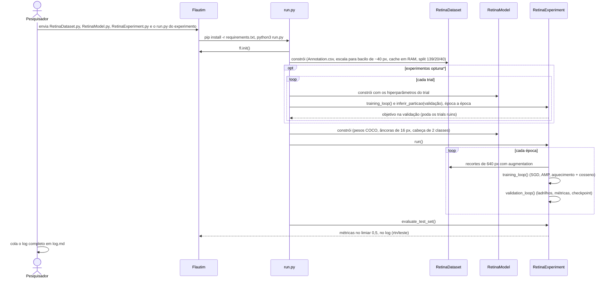
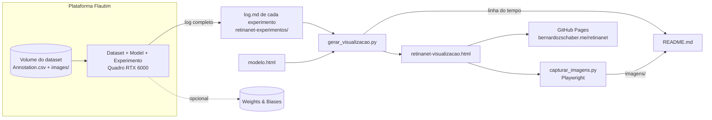

<table style="margin: auto; background-color: white;">
  <tr>
    <td style="background-color: white;">
      
    </td>
    <td style="background-color: white;">
      
    </td>
    <td style="background-color: white;">
      
    </td>
    <td style="background-color: white;">
      
    </td>
    <td style="background-color: white;">
      
    </td>
    <td style="background-color: white;">
      
    </td>
    <td style="background-color: white;">
      
    </td>
  </tr>
</table>

# RetinaNet para detecção de bacilos de Koch

Experimentos de hiperparâmetros com o RetinaNet R50-FPN v2 para detectar bacilos da tuberculose em lâminas coradas por Ziehl-Neelsen, executados na **[Plataforma Flautim](http://flautim.futurelab.dcc.ufmg.br/)** do FutureLab (DCC/UFMG). O objetivo é superar o RetinaNet da tese de Thales Carvalho no mesmo protocolo de avaliação, e entender por que cada mudança ajuda ou atrapalha.

## 🎯 Objetivo

O ponto de partida foi a tabela da tese (`resultados-thales.md`). Na média dos quatro datasets dela, o RetinaNet chega a:

| Precisão | Sensibilidade | F-measure | AP |
|---|---|---|---|
| 0,9339 | 0,4741 | 0,6244 | 0,4533 |

**Atalhos:** [🧭 Painel de diagnóstico](https://bernardozschaber.me/retinanet/retinanet-visualizacao/retinanet-visualizacao.html) · [🏆 Resultados](#-resultados-até-agora) · [🕒 Linha do tempo](#-linha-do-tempo) · [📚 Tutoriais da Flautim](#-tutoriais-da-flautim)

---

## 🏗️ Arquitetura

O projeto segue a divisão da plataforma Flautim em **Dataset**, **Model** e **Experiment**: `RetinaDataset.py`, `RetinaModel.py` e `RetinaExperiment.py`, na raiz do projeto. Os três são compartilhados por todos os experimentos e existem uma vez só. Cada pasta em `retinanet-experimentos/` guarda só o que muda de um experimento para outro: o `run.py` com os hiperparâmetros, o `requirements.txt`, o `hiperparametros.md`, que diz o que mudou e por quê, e, depois de rodar, o `log.md`.

Na hora de rodar, a Flautim junta os arquivos numa pasta só, sem subpastas, e executa `python3 run.py` dali. Por isso os imports são planos (`import RetinaDataset`) e o ponto de entrada sempre se chama `run.py`.

Os logs ficam no repositório de propósito. Eles são a fonte de verdade: o painel e os resultados deste README saem deles, com data e hora de cada treino.

```
RetinaDataset.py                Dataset da Flautim: lâminas reescaladas e cortadas em ladrilhos
RetinaModel.py                  Model da Flautim: RetinaNet R50-FPN v2 com âncoras pequenas
RetinaExperiment.py             Experiment da Flautim: ciclo de treino, avaliação e métricas
retinanet-experimentos/
  retinanet-<variação>/         um experimento: run.py, requirements.txt, hiperparametros.md
                                (o que mudou e por quê) e log.md (o log completo da Flautim)
                                  baseline e 9 variações de um hiperparâmetro: a 1ª rodada
                                  optuna*: buscas automáticas; wandb*: treinos acompanhados no W&B
                                  *Sementes: a mesma configuração com várias sementes (média ± desvio)
retinanet-visualizacao/         painel gerado a partir dos logs, imagens do README e scripts
resultados-thales.md            tabelas da tese usadas como referência
```

### 🧩 Como o projeto se encaixa na Flautim

Todo projeto Flautim estende a interface de programação da plataforma, a `flautim_api`. A figura, dos [tutoriais da Flautim](https://github.com/FutureLab-DCC/flautim_tutoriais), mostra o esquema. Aqui ele vira: `RetinaDataset` estende `Dataset`, `RetinaModel` estende `Model`, `RetinaExperiment` estende o `Experiment` centralizado, e o `run.py` de cada experimento usa o `common` para iniciar a plataforma e registrar o log.

<div align="center">
  
</div>

### 📐 Diagrama de classes

As três classes da base estendem as classes da Flautim. Os experimentos que precisam de algo a mais (enviar métricas ao W&B, escolher o checkpoint pelo critério da tese ou guardar um por regra de escolha) estendem o `RetinaExperiment` dentro do próprio `run.py`, sem tocar na base.



### 🔄 Diagrama de sequência (um experimento na Flautim)



### 🧱 Diagrama de componentes



---

## 🔬 O problema e a estratégia

As 200 lâminas do `Annotation.csv` têm até 2560 × 2557 px e 3145 caixas anotadas (2941 bacilos e 204 aglomerados, tratados como uma classe só). O bacilo mediano tem ~72 px de lado. Encolher a lâmina inteira para caber na rede deixaria os bacilos com poucos pixels, então o `RetinaDataset` faz o contrário:

1. reescala cada lâmina para o bacilo mediano ficar com ~40 px (fator 0,5533 neste dataset);
2. treina com recortes de 640 × 640 px, a maioria centrados num bacilo, com espelhamentos, rotações e variação de cor da coloração;
3. avalia a lâmina inteira em ladrilhos com sobreposição e junta as detecções com NMS.

O split é por lâmina, com semente fixa: 139 de treino, 20 de validação e 40 de teste (614 bacilos). Uma das 200 imagens é ilegível e fica de fora.

---

## 📏 Protocolo de avaliação

Para os números serem comparáveis com a tese, o `RetinaExperiment` reproduz o notebook do Thales:

- uma detecção acerta se tem IoU ≥ 0,1 com um bacilo ainda não casado, em ordem de score (o bacilo é fino e a anotação é imprecisa, então IoU 0,5 puniria caixas corretas);
- Precisão, Sensibilidade e F-measure são medidas no limiar de score **0,5**;
- o AP (`AP_TESE`) varre os limiares de 0,20 a 0,85.

A comparação com a tese é sempre no limiar 0,5. O limiar escolhido na validação dá números melhores, mas muda a régua. O log também traz AP_VOC e as métricas com IoU 0,5 (AP50, F1_IOU50), que a tese não reporta.

---

## 🚀 Rodar um experimento na Flautim

Envie para a plataforma:

- **Dataset:** `RetinaDataset.py`;
- **Model:** `RetinaModel.py`;
- **Experiment:** `RetinaExperiment.py`, junto com o `run.py` e o `requirements.txt` da pasta do experimento em `retinanet-experimentos/`. O `hiperparametros.md` e o `log.md` não precisam subir.

Dataset, Model e Experiment são os mesmos para todos os experimentos; o que muda de um experimento para outro está só na pasta dele. Nos experimentos da 1ª rodada o `requirements.txt` é propositalmente vazio; nos com Optuna ou W&B ele instala esses pacotes.

O dataset é lido de `/home/flautim_workplace/datasets/db_tb/Dataset/` (ou da mesma árvore sob `/mnt`, conforme o cluster). Quase todo hiperparâmetro pode ser trocado por variável de ambiente sem editar código, por exemplo `RETINA_LR`, `RETINA_EPOCHS`, `RETINA_BATCH_SIZE` e `RETINA_SEEDS`; cada `run.py` lista as suas no topo.

Não acrescente pacotes ao `requirements.txt` sem travar `numpy==1.26.4`. A imagem da plataforma (`experiments-gpu:0.2`, Python 3.12) foi compilada contra o NumPy 1.x, e um pacote que puxe o NumPy 2 quebra torch, cv2 e pycocotools de uma vez. Foi o que derrubou um treino em 17/09/2026, e é por isso que o dataset não usa albumentations.

Um treino de 30 épocas leva de 20 a 36 minutos numa Quadro RTX 6000 e usa menos de 5 GB de VRAM. As buscas com Optuna levam de 2 a 3 horas.

---

## 🧪 Criar um experimento novo

1. Copie a pasta do experimento mais parecido com o que você quer testar e renomeie no padrão `retinanet-<variacaoEmCamelCase>`. A cópia já leva o `requirements.txt`.
2. Mude os valores padrão no `run.py` e diga no `hiperparametros.md` o que mudou e por quê.
3. Depois de rodar, cole o **log completo** da plataforma em `log.md`, na pasta do experimento. Só as últimas linhas não bastam: o tempo de treino e as curvas por época estão no meio do log.
4. Rode `python3 gerar_visualizacao.py` em `retinanet-visualizacao/`. O experimento entra sozinho no painel e na linha do tempo deste README. Para atualizar as imagens do README, rode também `python3 capturar_imagens.py`.

Os experimentos com Optuna e com sementes ajustam a perda focal (`focal_alpha`, `focal_gamma`) e o matcher de âncoras (`fg_iou`) dentro do próprio `run.py`, sem tocar no `RetinaModel.py`. Copie essas funções junto se o seu experimento precisar delas.

---

## 📊 Painel de diagnóstico

O painel junta todos os experimentos numa página: **[abrir o painel](https://bernardozschaber.me/retinanet/retinanet-visualizacao/retinanet-visualizacao.html)**. Ele também abre direto do arquivo `retinanet-visualizacao/retinanet-visualizacao.html`, e funciona nos temas claro e escuro.

As cores seguem a coloração de Ziehl-Neelsen, o método padrão do diagnóstico da tuberculose: **fucsina**, a cor em que o bacilo fica, marca este trabalho; **azul de metileno**, a contracoloração do fundo da lâmina, marca a tese.

<picture>
  <source media="(prefers-color-scheme: dark)" srcset="retinanet-visualizacao/imagens/01-resumo-escuro.png">
  
</picture>

**Folga sobre a tese.** Cada experimento contra cada uma das quatro métricas, como diferença para a média do RetinaNet da tese. É a resposta direta à pergunta do projeto: quem supera a tese, em quê e por quanto. A marca "4/4" indica quem supera as quatro ao mesmo tempo.

<picture>
  <source media="(prefers-color-scheme: dark)" srcset="retinanet-visualizacao/imagens/02-folga-sobre-a-tese-escuro.png">
  
</picture>

**Ponto de operação.** Precisão contra sensibilidade no limiar 0,5. A área sombreada é onde as duas superam a tese. O gráfico mostra a troca que os experimentos com Optuna fizeram: mais sensibilidade, à custa de precisão abaixo da tese.

<picture>
  <source media="(prefers-color-scheme: dark)" srcset="retinanet-visualizacao/imagens/03-precisao-sensibilidade-escuro.png">
  
</picture>

**Mínimo, média e máximo.** Um candlestick por grupo: os 4 datasets da tese, as 10 configurações da 1ª rodada e cada experimento com várias sementes. O pavio vai do mínimo ao máximo e o corpo cobre média ± desvio, então dá para comparar a variação, e não só a média.

<picture>
  <source media="(prefers-color-scheme: dark)" srcset="retinanet-visualizacao/imagens/04-candlestick-escuro.png">
  
</picture>

**Matriz de confusão da detecção.** Verdadeiros positivos, falsos positivos e bacilos perdidos de cada execução. Em detecção de objetos não existe verdadeiro negativo contável, porque o fundo da lâmina não é uma lista de objetos; por isso a curva ROC não se aplica, e o painel usa a curva precisão × sensibilidade no lugar dela.

<picture>
  <source media="(prefers-color-scheme: dark)" srcset="retinanet-visualizacao/imagens/05-matriz-de-confusao-escuro.png">
  
</picture>

**Curva precisão × sensibilidade no teste.** A curva completa de cada semente dos quatro experimentos que a gravam no log (optunaSuperaTese, wandbSementesSuperaTese, wandbSementesAlpha030 e wandbSementesFocalF1Alpha055, 23 curvas), com o limiar indo de 0,05 a 0,95 e o ponto do limiar 0,5 marcado, ao lado dos pontos da tese. Mostra quanto de sensibilidade o modelo ganharia baixando o limiar, e onde ele deixaria de superar a tese em precisão.

<picture>
  <source media="(prefers-color-scheme: dark)" srcset="retinanet-visualizacao/imagens/07-curva-pr-teste-escuro.png">
  
</picture>

**Curva de aprendizado.** A métrica da validação época a época, com a faixa entre a melhor e a pior semente. Mostra quando o treino estabiliza e quanto as sementes divergem.

<picture>
  <source media="(prefers-color-scheme: dark)" srcset="retinanet-visualizacao/imagens/06-curva-de-aprendizado-escuro.png">
  
</picture>

**Escolha do checkpoint.** Uma tabela com as regras de escolha da época que os experimentos `wandbSementesSuperaTese`, `wandbSementesAlpha030` (quatro regras) e `wandbSementesFocalF1Alpha055` (três) aplicam ao mesmo treino, com a época escolhida em cada semente e quantas sementes superam a tese. É a base da seção de resultados sobre o checkpoint.

O painel traz ainda o custo em tempo de treino, a tabela completa, os hiperparâmetros de cada treino e a linha do tempo que está no fim deste README.

### 🔁 Atualizar o painel

`retinanet-visualizacao/gerar_visualizacao.py` lê os logs e gera o painel, sem nenhum pacote além da biblioteca padrão do Python. O mesmo script reescreve a linha do tempo deste README. O visual fica em `modelo.html`: para mudar o painel, edite o modelo e gere de novo, porque o HTML gerado é sobrescrito a cada execução. As imagens acima saem de `capturar_imagens.py`, que precisa do Playwright com Chromium. Cada uma tem duas versões com fundo transparente, uma do tema claro e outra do tema escuro do painel, e o GitHub mostra a que combina com o tema de quem lê.

---

## 🏆 Resultados até agora

No teste, limiar 0,5. As linhas com ± são médias de várias sementes, que é a forma justa de comparar com a tese. Nos experimentos com vários checkpoints por semente, a linha é a do critério principal, declarado antes de rodar.

| Execução | Precisão | Sensibilidade | F-measure | AP | Supera as 4 médias? |
|---|---|---|---|---|---|
| Tese, RetinaNet (média dos 4 datasets) | 0,9339 | 0,4741 | 0,6244 | 0,4533 | referência |
| Baseline | 0,9537 | 0,6042 | 0,7398 | 0,5963 | sim |
| altoLearningRate (1ª rodada) | 0,9355 | 0,6612 | 0,7748 | 0,6431 | sim, por +0,0016 na precisão |
| optunaSuperaTese (3 sementes) | 0,9629 ± 0,0067 | 0,5261 ± 0,0388 | 0,6799 ± 0,0337 | 0,5176 ± 0,0382 | sim, nas 3 sementes |
| **wandbSementesSuperaTese** (5 sementes) | **0,9605 ± 0,0095** | 0,5401 ± 0,0364 | 0,6909 ± 0,0311 | 0,5308 ± 0,0359 | **sim, nas 5 sementes** |
| **wandbSementesAlpha030** (5 sementes) | **0,9603 ± 0,0120** | 0,5524 ± 0,0348 | 0,7007 ± 0,0266 | 0,5423 ± 0,0334 | **sim, nas 5 sementes** |
| wandbSementes (5 sementes) | 0,8787 ± 0,0288 | 0,8352 ± 0,0388 | 0,8553 ± 0,0091 | 0,8066 ± 0,0323 | não (precisão) |
| **wandbSementesFocalF1** (5 sementes) | 0,8459 ± 0,0172 | **0,8844 ± 0,0256** | **0,8643 ± 0,0037** | **0,8414 ± 0,0229** | não (precisão) |
| wandbSementesFocalF1Alpha055 (10 sementes) | 0,8752 ± 0,0100 | 0,8458 ± 0,0135 | 0,8601 ± 0,0050 | 0,8109 ± 0,0114 | não (precisão) |

Os três experimentos mais recentes guardam um checkpoint por regra de escolha da época em cada semente: quatro regras nos dois de 12/10 e três no de 14/10. As regras são medidas só na validação e o resultado é lido no teste. Aqui estão todas, com a época escolhida em cada semente e o número de sementes que superam as quatro médias da tese:

| Experimento | Regra | Épocas escolhidas | Precisão | Sensibilidade | F-measure | AP | Sementes que superam |
|---|---|---|---|---|---|---|---|
| wandbSementesSuperaTese (alpha 0,25) | sem_folga (principal) | 17, 11, 7, 25, 26 | 0,9605 ± 0,0095 | 0,5401 ± 0,0364 | 0,6909 ± 0,0311 | 0,5308 ± 0,0359 | 5/5 |
| | folga_001 | 17, 11, 23, 25, 26 | 0,9639 ± 0,0051 | 0,5336 ± 0,0383 | 0,6863 ± 0,0327 | 0,5256 ± 0,0378 | 5/5 |
| | ap_voc | 22, 11, 17, 21, 23 | 0,9634 ± 0,0155 | 0,5417 ± 0,0494 | 0,6921 ± 0,0376 | 0,5340 ± 0,0456 | 5/5 |
| | ultima | 30, 30, 30, 30, 30 | 0,9624 ± 0,0115 | 0,5557 ± 0,0417 | 0,7036 ± 0,0307 | 0,5471 ± 0,0380 | 5/5 |
| wandbSementesAlpha030 (alpha 0,30) | sem_folga (principal) | 17, 20, 16, 19, 12 | 0,9603 ± 0,0120 | 0,5524 ± 0,0348 | 0,7007 ± 0,0266 | 0,5423 ± 0,0334 | 5/5 |
| | folga_001 | 17, 13, 16, 17, 12 | 0,9599 ± 0,0108 | 0,5322 ± 0,0298 | 0,6843 ± 0,0223 | 0,5230 ± 0,0282 | 5/5 |
| | ap_voc | 12, 28, 12, 16, 16 | 0,9466 ± 0,0215 | 0,5902 ± 0,1046 | 0,7214 ± 0,0775 | 0,5783 ± 0,1000 | 2/5 |
| | **ultima** | 30, 30, 30, 30, 30 | 0,9496 ± 0,0051 | 0,6251 ± 0,0205 | **0,7537 ± 0,0138** | 0,6137 ± 0,0185 | **5/5** |
| wandbSementesFocalF1Alpha055 (alpha 0,55) | **ultima (principal)** | 30 nas 10 sementes | 0,8752 ± 0,0100 | 0,8458 ± 0,0135 | **0,8601 ± 0,0050** | 0,8109 ± 0,0114 | 0/10 |
| | ap_voc | 23, 12, 25, 22, 22, 14, 28, 27, 15, 25 | 0,8726 ± 0,0105 | 0,8484 ± 0,0182 | 0,8601 ± 0,0070 | 0,8132 ± 0,0147 | 0/10 |
| | f1_val | 11, 25, 19, 27, 21, 9, 23, 26, 27, 19 | 0,8729 ± 0,0112 | 0,8425 ± 0,0167 | 0,8573 ± 0,0055 | 0,8064 ± 0,0132 | 0/10 |

Os achados principais:

- **Superar a tese nas quatro métricas ao mesmo tempo é robusto.** Com o critério principal, as 13 sementes dos três experimentos `*SuperaTese` e `Alpha030` superam as quatro médias, com folga de +0,027 a +0,029 na precisão (médias), a métrica que sempre foi o limite. Dos 19 experimentos rodados até 14/10/2026, 12 superam as quatro médias.
- **Existe uma troca entre precisão e F1, e o alpha da perda focal escolhe o ponto.** Com alpha 0,25 o modelo marca pouco e quase sempre certo, e supera a tese em tudo; com alpha 0,5 a 0,6 o F1 sobe para ~0,86, mas a precisão cai abaixo da tese. O gamma pesa sete vezes menos que o alpha.
- **O maior F1 do projeto é estável e estatisticamente confirmado.** O wandbSementesFocalF1 tem F1 0,8643 ± 0,0037, acima do wandbSementes com p = 0,032 num teste de permutação exato entre as 5 + 5 sementes.
- **Uma semente só engana.** Na primeira repetição com sementes, o resultado de uma execução isolada (F1 0,8634) era o melhor de cinco, e a média real foi 0,855. Diferenças de AP abaixo de ~0,03 entre execuções de uma semente são ruído.
- **A folga no checkpoint não era o gargalo.** O optunaSuperaTese exigia precisão de pelo menos 0,944 na validação e ficou com F1 0,68. O wandbSementesSuperaTese testou tirar a folga de 0,01: o F1 foi de 0,6863 para 0,6909, dentro do desvio entre sementes (0,03), e o critério com folga repetiu o 0,68 do optunaSuperaTese. A hipótese de que a folga custava F1 não se confirmou.
- **O problema é escolher a época pelo máximo de uma validação ruidosa.** A validação tem 20 lâminas, e a sensibilidade dela chega a ir de 0,14 para 0,71 em épocas vizinhas do mesmo treino. Escolher o máximo premia épocas de sorte: a época escolhida variou de 7 a 26 entre as sementes. A última época, sem seleção, deu o maior F1 nos dois experimentos e superou a tese em 5 de 5 sementes, porque no fim do cosseno a taxa de aprendizado é baixa e os checkpoints se estabilizam.
- **O alpha 0,30 só aparece quando se tira a seleção de época.** Com o critério principal, alpha 0,30 e 0,25 empatam (F1 +0,010, p = 0,59). Na última época, o alpha 0,30 chega a F1 0,7537 ± 0,0138 contra 0,7036 do alpha 0,25 (+0,050, p = 0,016) e a sensibilidade sobe 0,069 (p = 0,024). A precisão cai 0,013, para 0,9496, e continua +0,016 acima da tese nas cinco sementes. É o maior F1 entre as configurações que superam as quatro métricas em várias sementes, e chega perto dos 0,7748 do altoLearningRate, que tem uma semente só.
- **Escolher a época pelo AP_VOC é arriscado com alpha 0,30.** O F1 médio é 0,7214, mas só 2 de 5 sementes superam a tese: duas perdem na precisão (0,926 e 0,927) e uma na sensibilidade, com desvio de 0,0775.
- **Alpha 0,55 devolve precisão, mas não sobe o F1.** Com o mesmo critério do wandbSementesFocalF1 (AP_VOC na validação), o alpha 0,55 tem precisão 0,027 maior (p = 0,003 num teste de permutação exato entre as 10 + 5 sementes) e sensibilidade 0,036 menor (p = 0,008). O F1 fica igual (0,8601 contra 0,8643, p = 0,25) e o AP cai 0,028 (p = 0,014). O ponto de operação anda na mesma curva, e a precisão (0,875) continua abaixo da tese em 10 de 10 sementes.
- **A última época, declarada antes de rodar, não perde para a seleção.** No wandbSementesFocalF1Alpha055 ela empatou com o AP_VOC (F1 0,8601 nos dois, p = 0,98 pareado em 10 sementes) e ficou um pouco acima do F1 da validação (0,8573, p = 0,10), com o menor desvio dos três. A validação desta configuração é estável, então a escolha da época quase não importa aqui; o ganho de +0,050 da última época no alpha 0,30 veio de uma validação ruidosa e ainda não foi repetido.

Uma ressalva sobre o achado da última época no alpha 0,30: ela era um critério secundário, e foi a melhor das quatro regras vistas no teste. Os p-valores não corrigem essa escolha, e com 5 sementes pareadas o menor p possível é 0,0625 (a última época foi melhor em 5 de 5 sementes no alpha 0,30, com p = 0,0625 no teste pareado). Por isso o resultado é uma pista forte, e não uma conclusão.

O wandbSementesFocalF1Alpha055 declarou a última época como principal antes de rodar, mas numa configuração de validação estável, onde ela empatou com os outros critérios. Isso mostra que ela não piora o resultado, mas não confirma o ganho do alpha 0,30.

**Próximo passo sugerido:** repetir o alpha 0,30 (e talvez 0,35, que também passou a tese na validação da busca) com a última época declarada como critério principal antes de rodar, e com sementes novas (57 a 61, já que as 47 a 56 foram usadas no wandbSementesFocalF1Alpha055). Se o F1 de ~0,75 se repetir com a precisão acima de 0,934, a configuração vira a melhor das que superam a tese nas quatro métricas.


---

## 🕒 Linha do tempo

O que cada rodada ensinou, em ordem cronológica. Os horários de início e fim saem dos logs, e os números são os do teste no limiar 0,5. Este trecho é gerado por `gerar_visualizacao.py`; edite a lista `LINHA_DO_TEMPO` no script, não o texto abaixo.

<!-- linha-do-tempo:inicio -->
- **07/10/2026 (12:16–12:44) · Baseline** · _log auditado_ \
  `baseline` \
  `P 0,9537 · R 0,6042 · F1 0,7398 · AP 0,5963 · 27 min de treino` \
  **O que ensinou:** A configuração base já supera a média do RetinaNet da tese nas quatro métricas. A estratégia de ladrilhos de 640 px, com a imagem reescalada para o bacilo mediano ter ~40 px, resolve o problema dos bacilos pequenos demais. O ponto fraco é a sensibilidade: o modelo acerta quase tudo o que marca, mas deixa 40% dos bacilos sem marcar.

- **08/10/2026 (08:45–11:04) · 1ª rodada: um hiperparâmetro por vez** · _log auditado_ \
  `altoLearningRate` · `baixoLearningRate` · `altoEpochs` · `altoWeightDecay` · `altoImageSize` · `baixoImageSize` · `altoTargetBox` · `baixoTargetBox` · `baixoTrainableLayers` \
  `melhor: altoLearningRate, F1 0,7748 · AP 0,6431 · 8 de 10 configurações superam as 4 médias` \
  **O que ensinou:** Mexer no learning rate foi o que mais rendeu. Ladrilho e escala fora de 640 px / 40 px pioraram, e congelar camadas ou dobrar o weight decay também. 40 épocas ganharam só +0,005 de F1 por 31% a mais de tempo. O baixoTargetBox desabou (sensibilidade 0,22): bacilos a 32 px ficam pequenos demais para as âncoras. A pista mais importante: com o limiar escolhido na validação o F1 chegava a ~0,86, então o modelo já detectava bem e o problema era a calibração dos scores.

- **10/10/2026 · Decisão: comparar só no limiar 0,5** · _decisão_ \
  `alvo: P > 0,9339 · R > 0,4741 · F1 > 0,6244 · AP > 0,4533` \
  **Por quê:** O limiar escolhido na validação dá números melhores, mas muda a régua. Para a comparação com a tese ser justa, tudo passou a ser medido no limiar 0,5, e as análises com limiar menor saíram. A partir daqui, melhorar significa calibrar o modelo para o 0,5.

- **10/10/2026 (15:29–18:15) · 1ª busca com Optuna** · _log auditado_ \
  `optuna` \
  `P 0,8571 · R 0,8697 · F1 0,8634 · AP 0,8386 · busca 140 min + treino 27 min` \
  **O que ensinou:** O alpha da perda focal é a alavanca da calibração. Os 5 melhores trials usaram alpha 0,5, o maior valor permitido, contra 0,25 do padrão, e grad_clip 5. A sensibilidade saltou de 0,60 para 0,87 e o limiar ideal na validação subiu de 0,35 para 0,55: o 0,5 da tese virou praticamente o corte certo. O preço: a precisão caiu para 0,857, abaixo dos 0,934 da tese, e o AP50 caiu de 0,795 para 0,764, com caixas um pouco menos justas (fg_iou 0,4).

- **10/10/2026 (18:16–18:50) · Treino com Weights & Biases** · _log auditado_ \
  `wandb` \
  `P 0,9807 · R 0,4967 · F1 0,6595 · AP 0,4910 · 34 min de treino` \
  **O que ensinou:** Somar duas melhorias isoladas (lr 1e-2 e 40 épocas) com lote 8 não somou os ganhos: o F1 ficou abaixo do baseline. O melhor checkpoint saiu na época 13 de 40, então mais épocas não ajudaram. O W&B rodou offline por falta de chave, o que não atrapalha o treino: os gráficos só aparecem depois de um wandb sync.

- **10/10/2026 (19:35–22:06) · 2ª busca: focal loss e F1 no 0,5** · _log auditado_ \
  `optunaFocalF1` \
  `P 0,8281 · R 0,9104 · F1 0,8673 · AP 0,8593 · busca 125 min, 12 de 20 trials podados` \
  **O que ensinou:** O alpha virou o hiperparâmetro mais importante da busca (importância 0,33). O gamma pesou sete vezes menos (0,05): 1,5 e 2,0 deram resultados parecidos, e o vencedor usou 1,5, que suprime menos os exemplos fáceis e, junto com alpha 0,6, tende a empurrar os scores para cima. O alpha 0,75 não apareceu entre os 5 melhores, então o ótimo fica entre 0,5 e 0,6. Lote 8 apareceu em todos os 5 melhores. Com alpha 0,6 a calibração passou um pouco do ponto: o limiar ideal na validação foi 0,60 e a precisão caiu para 0,83.

- **10/10/2026 (22:00–00:11 de 11/10) · Cinco sementes da melhor configuração** · _log auditado_ \
  `wandbSementes` \
  `F1 0,8553 ± 0,0091 · AP 0,8066 ± 0,0323 · P 0,8787 ± 0,0288 · R 0,8352 ± 0,0388` \
  **O que ensinou:** A semente 42 repetiu exatamente o resultado da 1ª busca, prova de que o treino é reprodutível. Mas ela foi a melhor das cinco: o 0,8634 era otimista, e a média real é 0,855. O AP varia 3,5 vezes mais que o F1 entre sementes, então diferenças de AP abaixo de ~0,03 numa semente só são ruído. Mesmo assim, o F1 fica 0,18 acima do melhor dataset da tese, mais de seis desvios de distância.

- **11/10/2026 (22:54–00:56 de 12/10) · Cinco sementes da 2ª busca** · _log auditado_ \
  `wandbSementesFocalF1` \
  `F1 0,8643 ± 0,0037 · AP 0,8414 ± 0,0229 · P 0,8459 ± 0,0172 · R 0,8844 ± 0,0256 · 24,5 min por semente` \
  **O que ensinou:** A semente 42 repetiu F1 0,8673, então a configuração foi aplicada como deveria. Desta vez o ganho é real: +0,009 de F1 sobre o wandbSementes, com p = 0,032 num teste de permutação exato entre as 5 + 5 sementes, e +0,049 de sensibilidade (p = 0,040). O AP subiu 0,035, mas sem significância (p = 0,087). O desvio do F1 caiu para menos da metade (0,0037 contra 0,0091): alpha 0,6 com lote 8 é a configuração de maior F1 e a mais estável do projeto. O preço continua sendo a precisão, 0,846, abaixo dos 0,934 da tese.

- **11/10/2026 (22:54–02:03 de 12/10) · Superar as quatro médias ao mesmo tempo, com folga** · _log auditado_ \
  `optunaSuperaTese` \
  `P 0,9629 ± 0,0067 · R 0,5261 ± 0,0388 · F1 0,6799 ± 0,0337 · AP 0,5176 ± 0,0382 · 3 de 3 sementes superam as 4` \
  **O que ensinou:** Objetivo cumprido: as três sementes e a média superam as quatro métricas da tese, com +0,029 de folga na precisão. A busca voltou ao alpha 0,25 com lr ~0,011, praticamente o altoLearningRate da 1ª rodada: os três trials que passaram a tese na validação usaram alpha 0,25 ou 0,35, e learning rate e weight decay foram os hiperparâmetros mais importantes (0,41 e 0,29). Mas o F1 ficou em 0,68, abaixo dos 0,77 do altoLearningRate. O motivo é a escolha do checkpoint: ela exigia precisão de pelo menos 0,944 na validação, onde a precisão sai menor que no teste, e acabou ficando com épocas conservadoras, de sensibilidade baixa. As últimas épocas tinham F1 maior na validação (0,69 a 0,75). A curva precisão × sensibilidade do teste aponta para o mesmo lado: no limiar 0,45, as três sementes ainda superariam a tese em precisão e sensibilidade, com F1 de 0,73 a 0,79. Como isso foi visto no teste, é uma pista e não um resultado. Superar a tese nas quatro métricas é robusto; fazer isso com F1 alto pede uma folga menor na validação.

- **12/10/2026 (16:33–18:49) · Quatro critérios de checkpoint no mesmo treino** · _log auditado_ \
  `wandbSementesSuperaTese` \
  `P 0,9605 ± 0,0095 · R 0,5401 ± 0,0364 · F1 0,6909 ± 0,0311 · AP 0,5308 ± 0,0359 · 5 de 5 sementes superam as 4` \
  **O que ensinou:** Cinco sementes, cinco vezes acima da tese nas quatro métricas, com +0,027 de folga na precisão. A pergunta era se tirar a folga de 0,01 do checkpoint subia o F1. Subiu pouco: 0,6863 com folga e 0,6909 sem, dentro do desvio entre sementes (0,03). O critério folga_001 repete o optunaSuperaTese (0,6799), então aquele resultado se confirmou com mais sementes, e a folga não era o gargalo. O gargalo é escolher a época pelo máximo de uma validação pequena e ruidosa: numa mesma semente, a sensibilidade da validação foi de 0,14 na época 13 para 0,71 na 14, e a época escolhida variou de 7 a 26 entre as sementes. A última época, sem seleção nenhuma, teve o maior F1 (0,7036) e também superou a tese em 5 de 5; no fim do cosseno a taxa de aprendizado é baixa e os checkpoints se estabilizam. Os quatro critérios ficaram entre 0,686 e 0,704, sem diferença clara nesta configuração.

- **12/10/2026 (16:51–19:07) · Alpha 0,30 com o limiar fixo em 0,5** · _log auditado_ \
  `wandbSementesAlpha030` \
  `P 0,9603 ± 0,0120 · R 0,5524 ± 0,0348 · F1 0,7007 ± 0,0266 · AP 0,5423 ± 0,0334 · 5 de 5 sementes superam as 4` \
  **O que ensinou:** Com o critério principal, o alpha 0,30 não se distingue do 0,25: +0,010 de F1 (p = 0,59 num teste de permutação exato entre as 5 + 5 sementes) e a mesma precisão, 0,9603 contra 0,9605. O efeito do alpha aparece quando se tira a seleção de época. Na última época o alpha 0,30 chega a F1 0,7537 ± 0,0138, contra 0,7036 do alpha 0,25 (+0,050, p = 0,016), com sensibilidade 0,6251 (+0,069, p = 0,024) e precisão 0,9496, ainda +0,016 acima da tese nas cinco sementes. É o maior F1 entre as configurações que superam as quatro métricas em várias sementes, e o desvio é a metade do critério principal. Escolher a época pelo AP_VOC é arriscado com alpha 0,30: o F1 médio é 0,7214, mas só 2 de 5 sementes superam a tese (duas perdem na precisão, uma na sensibilidade), com desvio de 0,0775. A ressalva é que a última época era um critério secundário e foi a melhor de quatro vistas no teste, então o ganho precisa ser confirmado num experimento que a declare como principal antes de rodar.

- **14/10/2026 (17:44–21:59) · Alpha 0,55 e a última época declarada antes** · _log auditado_ \
  `wandbSementesFocalF1Alpha055` \
  `P 0,8752 ± 0,0100 · R 0,8458 ± 0,0135 · F1 0,8601 ± 0,0050 · AP 0,8109 ± 0,0114 · 10 sementes, 25,5 min cada` \
  **O que ensinou:** Baixar o alpha de 0,6 para 0,55 fez o que se esperava com a precisão e não mudou o F1. Comparando o mesmo critério do wandbSementesFocalF1 (AP_VOC na validação), a precisão subiu 0,027 (0,8726 contra 0,8459, p = 0,003 num teste de permutação exato entre as 10 + 5 sementes) e a sensibilidade caiu 0,036 (p = 0,008). O F1 ficou em 0,8601 contra 0,8643 (p = 0,25), e o AP caiu 0,028 (p = 0,014). A troca entre precisão e sensibilidade foi quase de um para um, então o alpha 0,55 só move o ponto de operação na mesma curva, e a precisão continua 0,059 abaixo da tese: 0 de 10 sementes superam as quatro métricas. A última época, agora declarada antes de rodar, empatou com o AP_VOC (F1 0,8601 nos dois, p = 0,98 pareado nas mesmas sementes) e ficou um pouco acima do F1 da validação (0,8573, p = 0,10), com o menor desvio dos três (0,0050). Como a validação desta configuração é estável, escolher a época quase não importa; o ganho de 0,05 do alpha 0,30 veio de uma validação ruidosa. A última época é o critério mais simples e não perdeu para os outros em nenhum dos três experimentos que a mediram.
<!-- linha-do-tempo:fim -->

---

## 📚 Tutoriais da Flautim

Este projeto segue a estrutura ensinada nos tutoriais oficiais da plataforma. Para aprender a montar um experimento do zero:

- 📚 [Tutorial 1](https://github.com/FutureLab-DCC/flautim_tutoriais/blob/main/TUTORIAL_1.ipynb) - Notebook com exemplo de classificação usando o dataset IRIS.
- 📚 [Tutorial 2](https://github.com/FutureLab-DCC/flautim_tutoriais/blob/main/TUTORIAL_2.ipynb) - Notebook com exemplo de regressão usando o dataset BOSTON.
- 📚 [Tutorial 3](https://github.com/FutureLab-DCC/flautim_tutoriais/blob/main/TUTORIAL_3.ipynb) - Notebook com exemplo de classificação de imagens usando o dataset MNIST.
- 📚 [Tutorial 4](https://github.com/FutureLab-DCC/flautim_tutoriais/blob/main/TUTORIAL_4.ipynb) - Notebook com exemplo de classificação de imagens usando o dataset FMNIST, com seleção de clientes em ambiente federado.
- 🎥 [Tutorial em vídeo](https://drive.google.com/file/d/1eC0CnIzZ-pKLTM6M9QvOmdZlBghjyL9J/view?usp=drive_link) - Como rodar o experimento do Tutorial 1 na plataforma, passo a passo.

## 📞 Fale com a Flautim

Dúvidas sobre a plataforma ou interesse em acessá-la: 💬 flautim@dcc.ufmg.br
